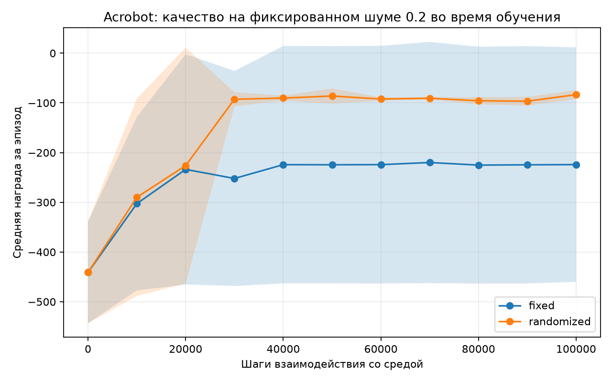
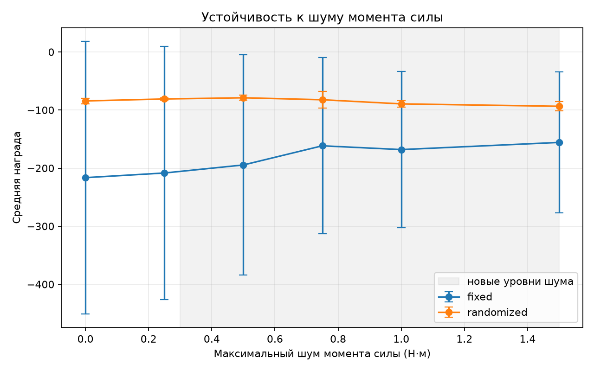
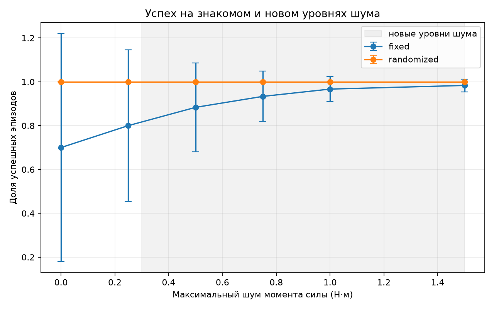

# Результаты: устойчивость PPO к шуму управления

## Исследовательский вопрос и гипотеза

**Вопрос.** Помогает ли случайный шум момента силы во время обучения сохранять качество Acrobot на уровнях шума, которых не было при обучении?

**Гипотеза.** Агент, обученный при шуме из диапазона [0, 0.3] Н·м, может немного уступать без шума, но будет иметь более высокую награду и долю успеха при шуме 0.5–1.5 Н·м.

До обучения зафиксированы: один алгоритм PPO, бюджет 100,000 шагов на запуск, seed [11, 22, 33], 20 оценочных эпизодов на уровень шума. Меняется только режим шума при обучении. Во время оценки обучение и исследовательские действия отключены; seed эпизодов совпадают между условиями.

## Метрики

- награда эпизода: `-число шагов`, при достижении цели последний шаг даёт 0;
- доля успехов: эпизод завершился по `terminated`, а не по лимиту 500 шагов;
- кривая обучения: средняя награда на одном и том же наборе эпизодов с шумом 0.2 Н·м;
- полосы и погрешности: стандартное отклонение между средними значениями отдельных seed, не между отдельными эпизодами.

## Итоговое сравнение

| condition | noise | mean_return | return_std_between_seeds | success_rate | success_std_between_seeds | mean_steps | seeds |
|---|---|---|---|---|---|---|---|
| fixed | 0.000 | -216.417 | 234.679 | 0.700 | 0.520 | 217.117 | 3 |
| fixed | 0.250 | -208.417 | 217.878 | 0.800 | 0.346 | 209.217 | 3 |
| fixed | 0.500 | -194.583 | 189.596 | 0.883 | 0.202 | 195.467 | 3 |
| fixed | 0.750 | -161.583 | 151.618 | 0.933 | 0.116 | 162.517 | 3 |
| fixed | 1.000 | -168.117 | 134.534 | 0.967 | 0.058 | 169.083 | 3 |
| fixed | 1.500 | -155.767 | 121.620 | 0.983 | 0.029 | 156.750 | 3 |
| random | 0.000 | -500.000 | 0.000 | 0.000 | 0.000 | 500.000 | 3 |
| random | 0.250 | -498.500 | 0.000 | 0.050 | 0.000 | 498.550 | 3 |
| random | 0.500 | -500.000 | 0.000 | 0.000 | 0.000 | 500.000 | 3 |
| random | 0.750 | -500.000 | 0.000 | 0.000 | 0.000 | 500.000 | 3 |
| random | 1.000 | -494.650 | 0.000 | 0.050 | 0.000 | 494.700 | 3 |
| random | 1.500 | -484.550 | 0.000 | 0.100 | 0.000 | 484.650 | 3 |
| randomized | 0.000 | -84.367 | 4.922 | 1.000 | 0.000 | 85.367 | 3 |
| randomized | 0.250 | -80.967 | 2.200 | 1.000 | 0.000 | 81.967 | 3 |
| randomized | 0.500 | -78.917 | 4.425 | 1.000 | 0.000 | 79.917 | 3 |
| randomized | 0.750 | -82.300 | 14.240 | 1.000 | 0.000 | 83.300 | 3 |
| randomized | 1.000 | -89.417 | 5.808 | 1.000 | 0.000 | 90.417 | 3 |
| randomized | 1.500 | -93.567 | 8.062 | 1.000 | 0.000 | 94.567 | 3 |

## Ответ на вопрос

При новых уровнях шума 0.5–1.5 средняя награда fixed составила **-170.01**, randomized — **-86.05**. Средние доли успеха — **0.942** и **1.000** соответственно. Без шума награды равны **-216.42** и **-84.37**.

На этом бюджете и этих seed гипотеза **подтверждается** по заранее выбранному критерию: большей средней награде randomized на новых уровнях шума. Это результат ограниченного эксперимента, а не доказательство универсальности доменной рандомизации.

**Анализ неудачных запусков.** Несмотря на усреднение, отдельные обучающие запуски не сформировали надёжную политику даже без шума (успех < 50%): fixed/seed_33: успех 0.10, награда -487.4. Это показывает, что разброс между seed связан не только с малыми колебаниями награды: возможна полная неудача обучения при том же бюджете.

**Post-hoc проверка альтернативного объяснения.** После исключения запусков, не решивших исходную среду, средняя награда на новом шуме: fixed -83.80, randomized -86.05. Это исследовательский, а не основной критерий: он помогает отделить устойчивость уже обученной политики к шуму от вероятности неудачи самого обучения.

Для случайного бейзлайна одни и те же общие оценочные эпизоды повторяются под тремя метками seed для согласования с RL-запусками. Его нулевой разброс между этими метками не является оценкой статистической неопределённости; разброс обучения интерпретируется для fixed и randomized.

## Визуализация поведения

В каталоге сохранены GIF-анимации для обоих агентов при шуме 0.5 Н·м. В таблице `evaluation_episodes.csv` можно проверить каждый эпизод и его seed.

## Ограничения и следующий шаг

Только три обучающих seed и одна среда; доверительные выводы о небольших различиях нельзя делать по числу эпизодов, потому что основная неопределённость связана с обучением. Далее стоит повторить эксперимент на 5–10 seed и проверить, сохраняется ли эффект при другом диапазоне рандомизации.
