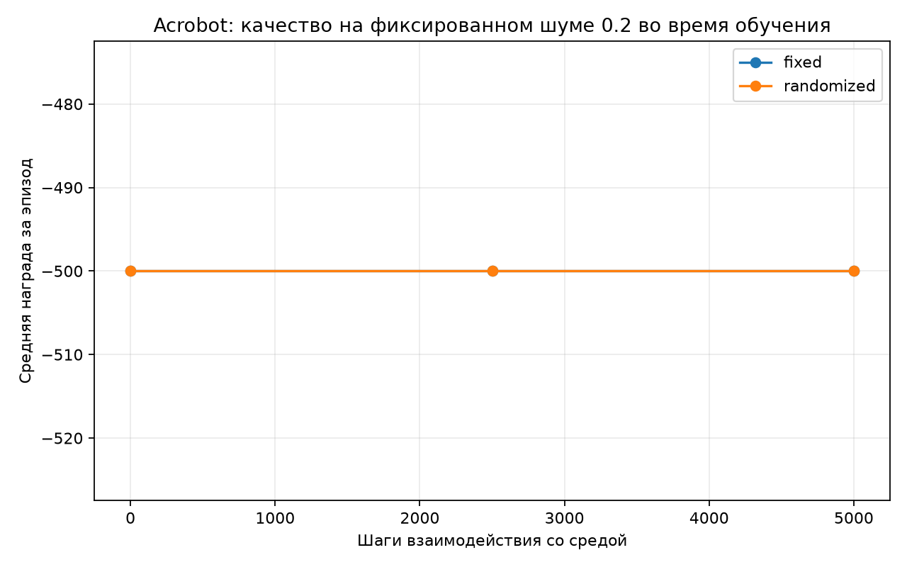
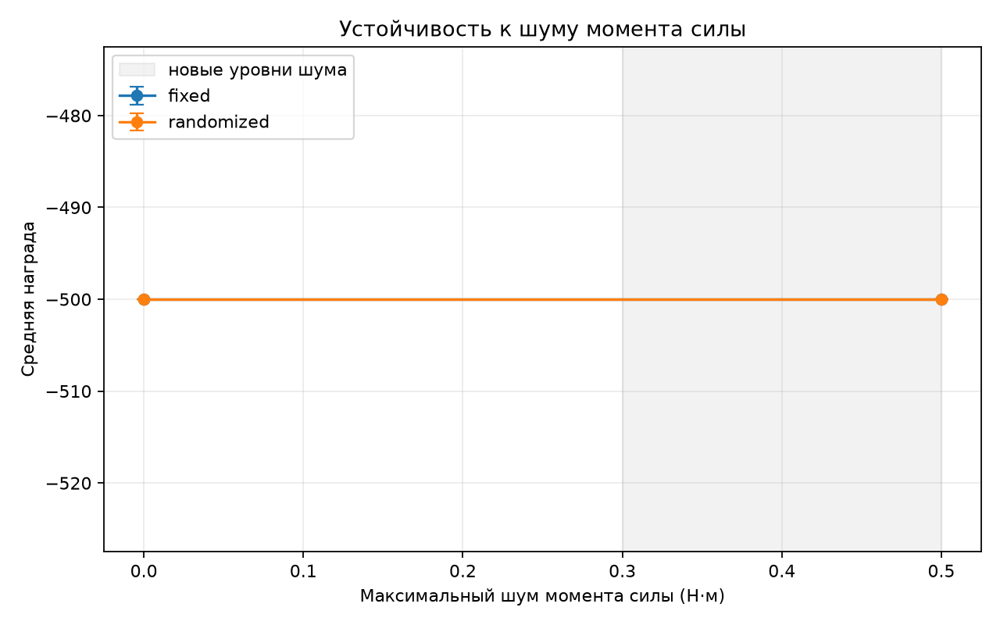
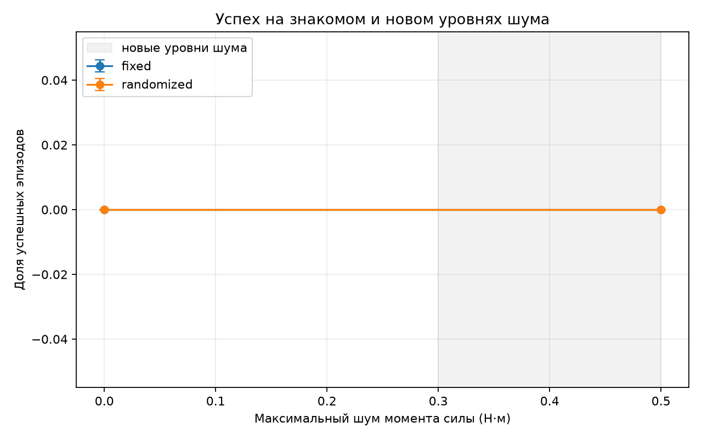

# Результаты: устойчивость PPO к шуму управления

## Исследовательский вопрос и гипотеза

**Вопрос.** Помогает ли случайный шум момента силы во время обучения сохранять качество Acrobot на уровнях шума, которых не было при обучении?

**Гипотеза.** Агент, обученный при шуме из диапазона [0, 0.3] Н·м, может немного уступать без шума, но будет иметь более высокую награду и долю успеха при шуме 0.5–1.5 Н·м.

До обучения зафиксированы: один алгоритм PPO, бюджет 5,000 шагов на запуск, seed [11], 2 оценочных эпизодов на уровень шума. Меняется только режим шума при обучении. Во время оценки обучение и исследовательские действия отключены; seed эпизодов совпадают между условиями.

## Метрики

- награда эпизода: `-число шагов`, при достижении цели последний шаг даёт 0;
- доля успехов: эпизод завершился по `terminated`, а не по лимиту 500 шагов;
- кривая обучения: средняя награда на одном и том же наборе эпизодов с шумом 0.2 Н·м;
- полосы и погрешности: стандартное отклонение между средними значениями отдельных seed, не между отдельными эпизодами.

## Итоговое сравнение

| condition | noise | mean_return | return_std_between_seeds | success_rate | success_std_between_seeds | mean_steps | seeds |
|---|---|---|---|---|---|---|---|
| fixed | 0.000 | -500.000 | 0.000 | 0.000 | 0.000 | 500.000 | 1 |
| fixed | 0.500 | -500.000 | 0.000 | 0.000 | 0.000 | 500.000 | 1 |
| random | 0.000 | -500.000 | 0.000 | 0.000 | 0.000 | 500.000 | 1 |
| random | 0.500 | -500.000 | 0.000 | 0.000 | 0.000 | 500.000 | 1 |
| randomized | 0.000 | -500.000 | 0.000 | 0.000 | 0.000 | 500.000 | 1 |
| randomized | 0.500 | -500.000 | 0.000 | 0.000 | 0.000 | 500.000 | 1 |

## Ответ на вопрос

При новых уровнях шума 0.5–1.5 средняя награда fixed составила **-500.00**, randomized — **-500.00**. Средние доли успеха — **0.000** и **0.000** соответственно. Без шума награды равны **-500.00** и **-500.00**.

На этом бюджете и этих seed гипотеза **не подтверждается** по заранее выбранному критерию: большей средней награде randomized на новых уровнях шума. Это результат ограниченного эксперимента, а не доказательство универсальности доменной рандомизации.

**Анализ неудачных запусков.** Несмотря на усреднение, отдельные обучающие запуски не сформировали надёжную политику даже без шума (успех < 50%): fixed/seed_11: успех 0.00, награда -500.0; randomized/seed_11: успех 0.00, награда -500.0. Это показывает, что разброс между seed связан не только с малыми колебаниями награды: возможна полная неудача обучения при том же бюджете.

Для случайного бейзлайна одни и те же общие оценочные эпизоды повторяются под тремя метками seed для согласования с RL-запусками. Его нулевой разброс между этими метками не является оценкой статистической неопределённости; разброс обучения интерпретируется для fixed и randomized.

## Визуализация поведения

В каталоге сохранены GIF-анимации для обоих агентов при шуме 0.5 Н·м. В таблице `evaluation_episodes.csv` можно проверить каждый эпизод и его seed.

## Ограничения и следующий шаг

Только три обучающих seed и одна среда; доверительные выводы о небольших различиях нельзя делать по числу эпизодов, потому что основная неопределённость связана с обучением. Далее стоит повторить эксперимент на 5–10 seed и проверить, сохраняется ли эффект при другом диапазоне рандомизации.
