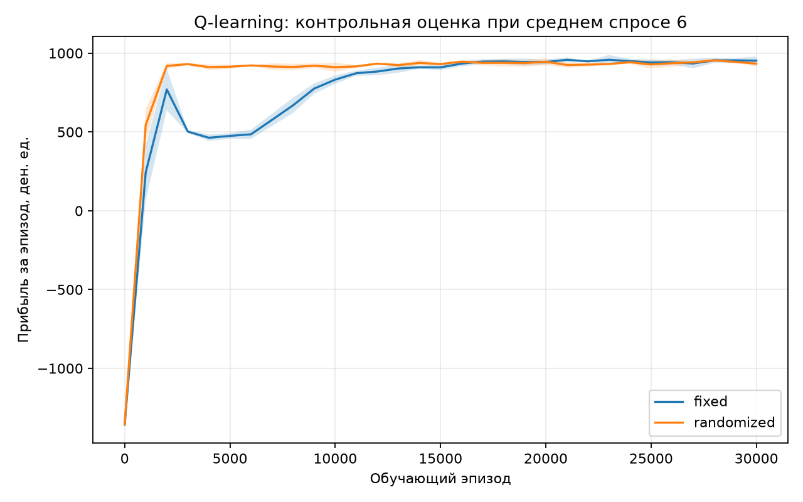
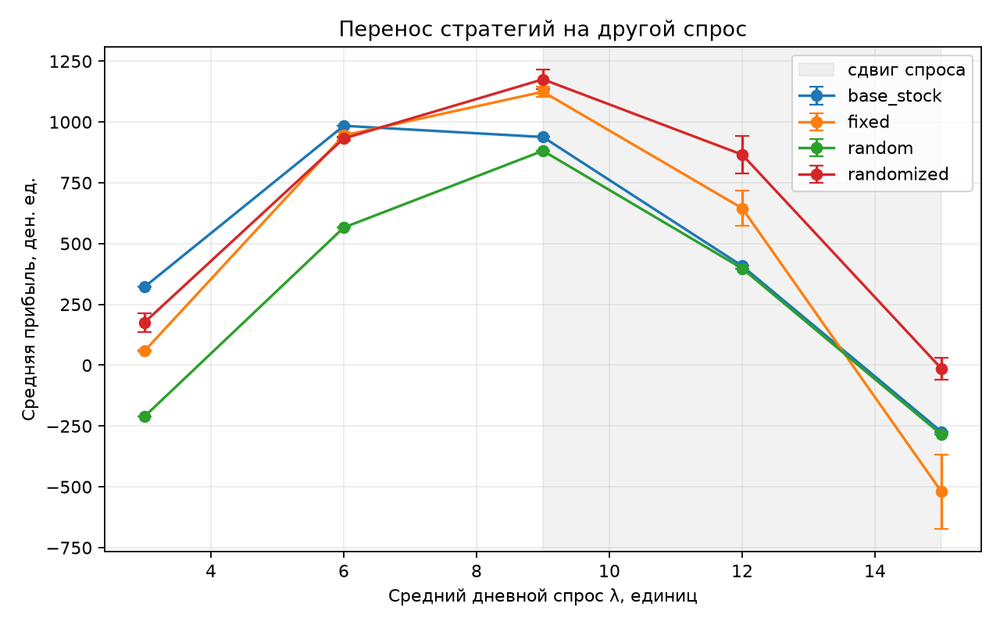
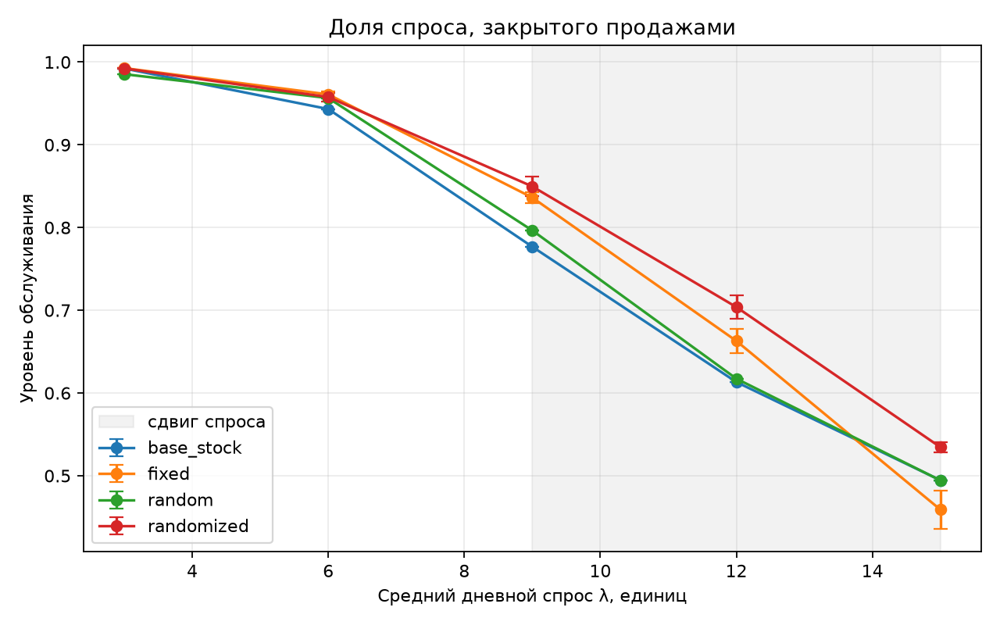

# Результаты: перенос RL-стратегии управления запасами

## Вопрос, гипотеза и план

**Вопрос.** Улучшает ли случайное изменение среднего спроса λ ∈ [3, 9] во время обучения прибыль и уровень обслуживания при незнакомом высоком спросе λ = 12 и 15?

**Гипотеза.** Randomized-агент может уступать fixed при исходном λ = 6, но получит более высокую среднюю прибыль при λ = 12–15, поскольку чаще видел дефицит и необходимость страхового запаса.

Сравниваются только два режима обучения: постоянный λ = 6 и эпизодическая рандомизация λ ∈ [3, 9]. Алгоритм, 30,000 эпизодов по 30 дней, seed [11, 22, 33] и оценочные seed совпадают. Дополнительные ориентиры: order-up-to с S = 15 и случайные заказы.

## Среда и экономическая награда

Действие — заказ 0–15 единиц, поставка приходит на следующий день. Спрос пуассоновский; незакрытый спрос теряется. Наблюдение — складская позиция (остаток + поставка) и спрос предыдущего дня, ограниченный значением 25. Эпизод длится 30 дней. Заказ автоматически ограничен вместимостью 30 единиц.

Награда в денежных единицах: `12 × продажи − 5 × заказ − 1 × остаток − 8 × потерянный спрос`. Она напрямую связывает решение с маржой, хранением и стоимостью дефицита. Уровень обслуживания — суммарные продажи / суммарный спрос; он показывает, не достигается ли прибыль за счёт отказа клиентам.

## Результаты

| condition | demand_mean | mean_profit | profit_std_between_seeds | service_level | service_std_between_seeds | lost_sales | holding_units | orders | seeds |
|---|---|---|---|---|---|---|---|---|---|
| base_stock | 3.000 | 322.020 | 0.000 | 0.992 | 0.000 | 0.700 | 263.860 | 96.600 | 3 |
| base_stock | 6.000 | 984.400 | 0.000 | 0.943 | 0.000 | 10.260 | 104.920 | 174.680 | 3 |
| base_stock | 9.000 | 938.160 | 0.000 | 0.777 | 0.000 | 60.040 | 29.380 | 211.740 | 3 |
| base_stock | 12.000 | 408.060 | 0.000 | 0.613 | 0.000 | 138.640 | 7.560 | 222.620 | 3 |
| base_stock | 15.000 | -273.400 | 0.000 | 0.494 | 0.000 | 227.860 | 2.460 | 224.620 | 3 |
| fixed | 3.000 | 58.660 | 4.042 | 0.993 | 0.000 | 0.660 | 487.020 | 104.800 | 3 |
| fixed | 6.000 | 944.820 | 12.512 | 0.961 | 0.004 | 7.067 | 177.300 | 180.893 | 3 |
| fixed | 9.000 | 1124.307 | 20.870 | 0.836 | 0.006 | 44.053 | 70.933 | 230.147 | 3 |
| fixed | 12.000 | 645.413 | 72.632 | 0.663 | 0.015 | 120.840 | 30.540 | 241.753 | 3 |
| fixed | 15.000 | -519.967 | 152.925 | 0.459 | 0.023 | 243.880 | 8.427 | 208.660 | 3 |
| random | 3.000 | -210.680 | 0.000 | 0.985 | 0.000 | 1.320 | 701.860 | 113.060 | 3 |
| random | 6.000 | 565.980 | 0.000 | 0.957 | 0.000 | 7.860 | 477.640 | 193.420 | 3 |
| random | 9.000 | 881.540 | 0.000 | 0.796 | 0.000 | 54.740 | 135.100 | 223.120 | 3 |
| random | 12.000 | 397.960 | 0.000 | 0.617 | 0.000 | 137.180 | 36.860 | 224.620 | 3 |
| random | 15.000 | -284.840 | 0.000 | 0.494 | 0.000 | 227.920 | 10.500 | 225.060 | 3 |
| randomized | 3.000 | 176.247 | 38.213 | 0.992 | 0.001 | 0.693 | 388.100 | 100.933 | 3 |
| randomized | 6.000 | 932.280 | 7.511 | 0.958 | 0.005 | 7.647 | 182.707 | 180.000 | 3 |
| randomized | 9.000 | 1175.407 | 39.845 | 0.850 | 0.012 | 40.433 | 75.667 | 233.460 | 3 |
| randomized | 12.000 | 865.840 | 76.011 | 0.704 | 0.014 | 106.153 | 28.080 | 256.907 | 3 |
| randomized | 15.000 | -13.787 | 44.184 | 0.534 | 0.006 | 209.847 | 7.780 | 243.687 | 3 |

## Ответ и интерпретация

При λ = 12–15 средняя прибыль fixed — **62.72**, randomized — **426.03**, order-up-to — **67.33**. При λ = 6 прибыль fixed — **944.82**, randomized — **932.28**, order-up-to — **984.40**.

По заранее выбранному критерию прибыли на новом высоком спросе гипотеза **подтверждается**. Поведение на одинаковом эпизоде показано в `trajectories.png`, а выбранные заказы — в `policy_heatmap.png`. Низкая прибыль случайной стратегии сама по себе не доказывает качество RL; содержательное сравнение — с order-up-to и между двумя RL-агентами на одних начальных состояниях и спросе. Сопоставление прибыли, уровня обслуживания, потерянных продаж, хранения и заказов позволяет увидеть, за счёт чего меняется результат, а не только итоговую награду.

Для `base_stock` и `random` одинаковые общие оценочные эпизоды повторяются под тремя метками seed, чтобы сохранить согласование с тремя RL-запусками. Поэтому их нулевой разброс между этими метками **не является оценкой статистической неопределённости**. Разброс обучения имеет смысл интерпретировать прежде всего для fixed и randomized.

## Ограничения

Модель предполагает известную экономику и пуассоновский спрос, не моделирует возвраты и сроки годности. Всего три seed; разброс эпизодов не заменяет разброс обучения. Для реального бизнеса выводы носят демонстрационный характер. Далее стоит проверить выбросы спроса и сравнить с оптимальной политикой, рассчитанной динамическим программированием на малой сетке.
