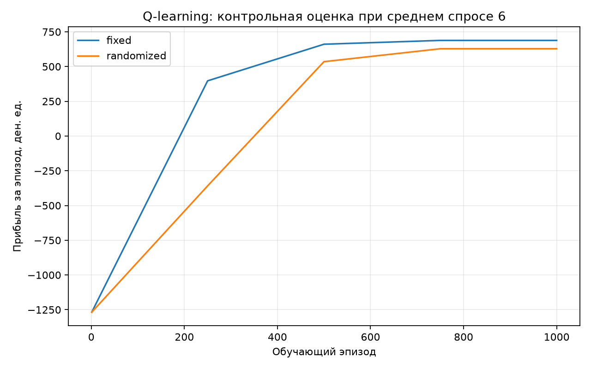
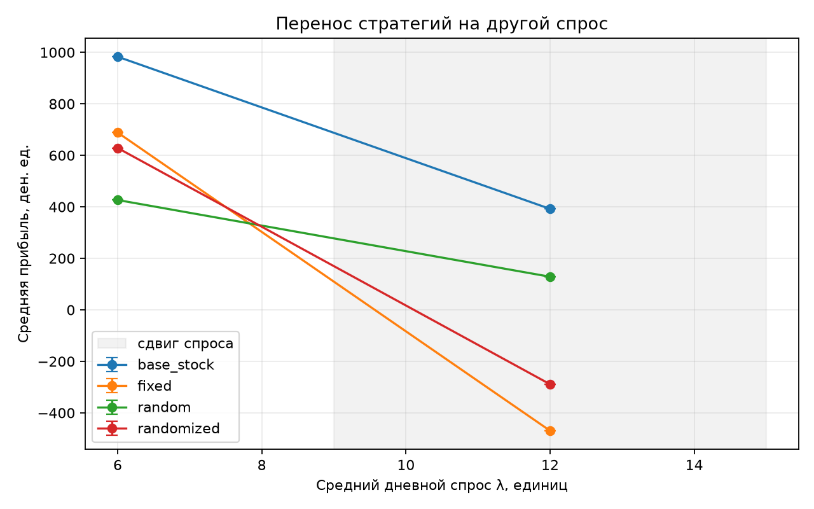
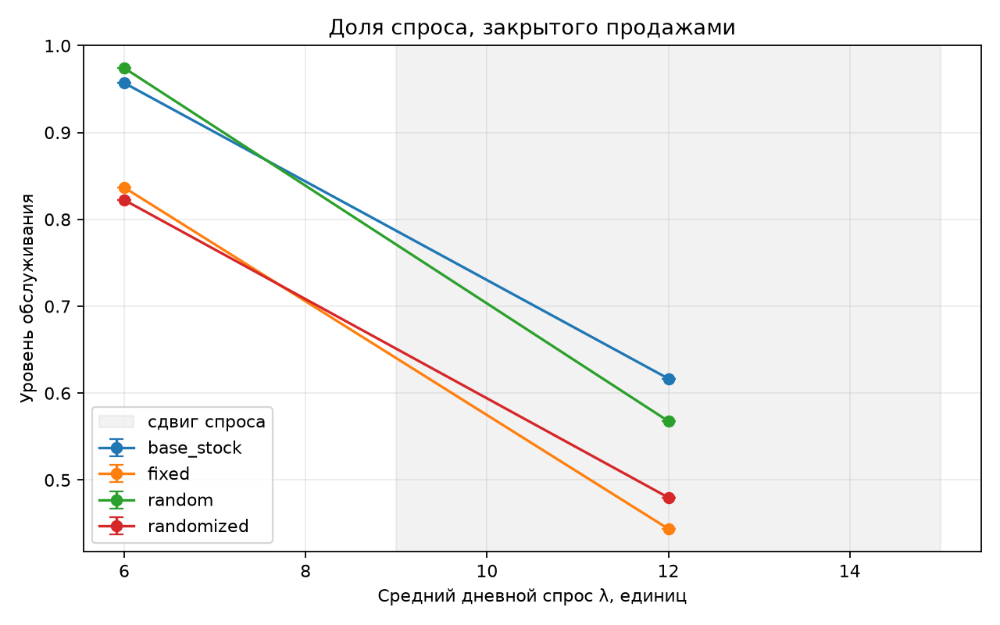

# Результаты: перенос RL-стратегии управления запасами

## Вопрос, гипотеза и план

**Вопрос.** Улучшает ли случайное изменение среднего спроса λ ∈ [3, 9] во время обучения прибыль и уровень обслуживания при незнакомом высоком спросе λ = 12 и 15?

**Гипотеза.** Randomized-агент может уступать fixed при исходном λ = 6, но получит более высокую среднюю прибыль при λ = 12–15, поскольку чаще видел дефицит и необходимость страхового запаса.

Сравниваются только два режима обучения: постоянный λ = 6 и эпизодическая рандомизация λ ∈ [3, 9]. Алгоритм, 1,000 эпизодов по 30 дней, seed [11] и оценочные seed совпадают. Дополнительные ориентиры: order-up-to с S = 15 и случайные заказы.

## Среда и экономическая награда

Действие — заказ 0–15 единиц, поставка приходит на следующий день. Спрос пуассоновский; незакрытый спрос теряется. Наблюдение — складская позиция (остаток + поставка) и спрос предыдущего дня, ограниченный значением 25. Эпизод длится 30 дней. Заказ автоматически ограничен вместимостью 30 единиц.

Награда в денежных единицах: `12 × продажи − 5 × заказ − 1 × остаток − 8 × потерянный спрос`. Она напрямую связывает решение с маржой, хранением и стоимостью дефицита. Уровень обслуживания — суммарные продажи / суммарный спрос; он показывает, не достигается ли прибыль за счёт отказа клиентам.

## Результаты

| condition | demand_mean | mean_profit | profit_std_between_seeds | service_level | service_std_between_seeds | lost_sales | holding_units | orders | seeds |
|---|---|---|---|---|---|---|---|---|---|
| base_stock | 6.000 | 983.000 | 0.000 | 0.957 | 0.000 | 7.500 | 113.500 | 169.500 | 1 |
| base_stock | 12.000 | 392.000 | 0.000 | 0.617 | 0.000 | 133.000 | 17.000 | 219.000 | 1 |
| fixed | 6.000 | 688.500 | 0.000 | 0.837 | 0.000 | 28.500 | 100.500 | 147.000 | 1 |
| fixed | 12.000 | -469.500 | 0.000 | 0.444 | 0.000 | 193.000 | 11.000 | 152.500 | 1 |
| random | 6.000 | 426.500 | 0.000 | 0.974 | 0.000 | 4.500 | 612.500 | 193.000 | 1 |
| random | 12.000 | 128.500 | 0.000 | 0.568 | 0.000 | 150.000 | 33.000 | 200.500 | 1 |
| randomized | 6.000 | 628.500 | 0.000 | 0.822 | 0.000 | 31.000 | 105.500 | 148.000 | 1 |
| randomized | 12.000 | -289.000 | 0.000 | 0.480 | 0.000 | 180.500 | 15.500 | 165.500 | 1 |

## Ответ и интерпретация

При λ = 12–15 средняя прибыль fixed — **-469.50**, randomized — **-289.00**, order-up-to — **392.00**. При λ = 6 прибыль fixed — **688.50**, randomized — **628.50**, order-up-to — **983.00**.

По заранее выбранному критерию прибыли на новом высоком спросе гипотеза **подтверждается**. Поведение на одинаковом эпизоде показано в `trajectories.png`, а выбранные заказы — в `policy_heatmap.png`. Низкая прибыль случайной стратегии сама по себе не доказывает качество RL; содержательное сравнение — с order-up-to и между двумя RL-агентами на одних начальных состояниях и спросе. Сопоставление прибыли, уровня обслуживания, потерянных продаж, хранения и заказов позволяет увидеть, за счёт чего меняется результат, а не только итоговую награду.

Для `base_stock` и `random` одинаковые общие оценочные эпизоды повторяются под тремя метками seed, чтобы сохранить согласование с тремя RL-запусками. Поэтому их нулевой разброс между этими метками **не является оценкой статистической неопределённости**. Разброс обучения имеет смысл интерпретировать прежде всего для fixed и randomized.

## Ограничения

Модель предполагает известную экономику и пуассоновский спрос, не моделирует возвраты и сроки годности. Всего три seed; разброс эпизодов не заменяет разброс обучения. Для реального бизнеса выводы носят демонстрационный характер. Далее стоит проверить выбросы спроса и сравнить с оптимальной политикой, рассчитанной динамическим программированием на малой сетке.
