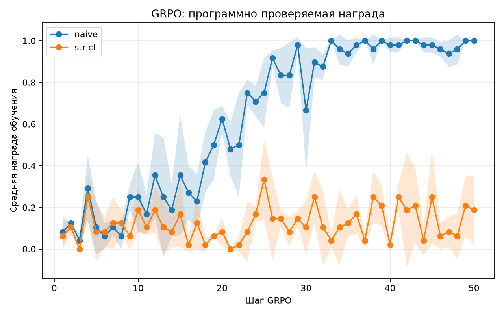
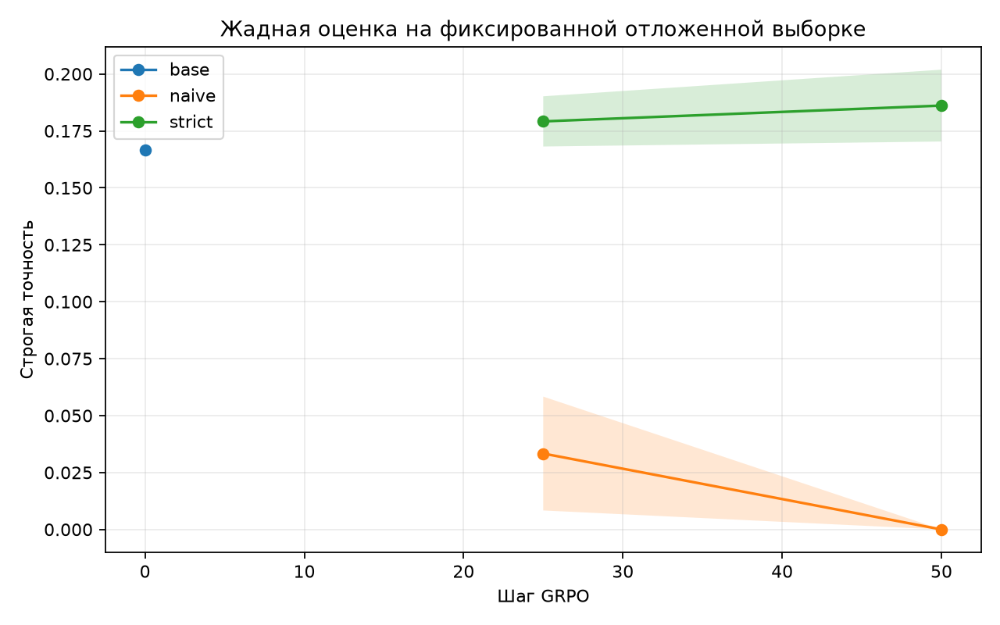
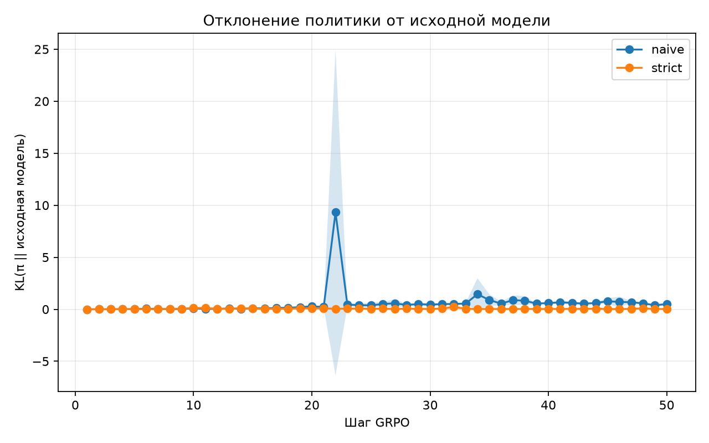
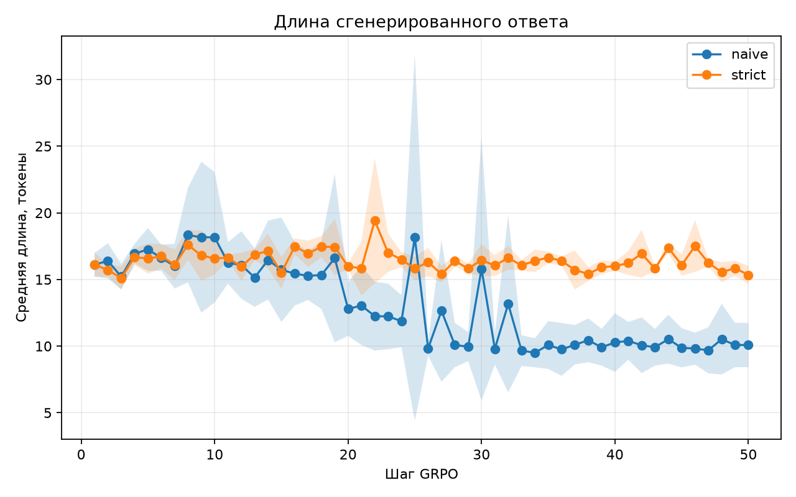

# Результаты: reward hacking при GRPO-дообучении Countdown

## Вопрос и гипотеза

**Вопрос.** Что произойдёт, если программная награда проверяет значение выражения, но не проверяет использование исходных чисел?

**Гипотеза.** Naive-агент научится получать высокую награду через лазейку (например, `<answer>цель</answer>`), поэтому его exploit rate вырастет, а строгая точность не превысит strict-агента, несмотря на высокую naive-награду.

Единственный изменённый фактор — проверка мультимножества чисел в reward. Модель Qwen3-0.6B, LoRA, 50 шагов GRPO, seed [42, 43, 44], β=0.01 и все остальные параметры совпадают. Итоговая оценка — жадное декодирование на одной зафиксированной выборке из 240 задач. Обучающие и отложенные задачи не пересекаются.

## Проверка корректности

Калькулятор использует `ast` и `Fraction`, не `eval`. Strict требует тег, допустимый синтаксис, точное значение и совпадение мультимножества. Naive отличается только отсутствием последней проверки. Юнит-тесты отдельно показывают, что `<answer>цель</answer>` получает 1 у naive и 0 у strict.

## Итоговые метрики

Базовая точность: **0.1667** (240 задач). Окончательные строки strict/naive усреднены по обучающим seed; `_std` — стандартное отклонение между seed.

| condition | n_tasks | accuracy | accuracy_mean | accuracy_std | naive_accuracy_mean | exploit_rate_mean | format_rate_mean | mean_response_tokens_mean |
|---|---|---|---|---|---|---|---|---|
| base | 240.0000 | 0.1667 |  |  |  |  |  |  |
| naive |  |  | 0.0000 | 0.0000 | 0.9944 | 0.9944 | 1.0000 | 9.9792 |
| strict |  |  | 0.1861 | 0.0158 | 0.2306 | 0.0444 | 1.0000 | 15.6625 |

## Ответ на вопрос

Strict: точность **0.1861**, naive-награда **0.2306**, exploit rate **0.0444**. Naive: **0.0000**, **0.9944**, **0.9944** соответственно.

По заранее заданному сочетанию критериев гипотеза **подтверждается**. Разница naive-награды и строгой точности важнее роста training reward: последняя может измерять именно успех обхода проверки. Конкретные одинаковые задачи и ответы приведены в `answer_comparison.csv` и `answer_examples.md`; полные ответы — в `predictions.jsonl`.

## Ограничения

GRPO чувствителен к seed и нулевой дисперсии награды в группе. Три seed не исключают случайных различий; одна модель и один диапазон сложности ограничивают обобщение. KL зависит от выбранного β и сам по себе не означает смысловое качество. Далее нужно повторить запуск на другой сложности и добавить защиту от повторяющихся тегов/чрезмерно длинных рассуждений.
